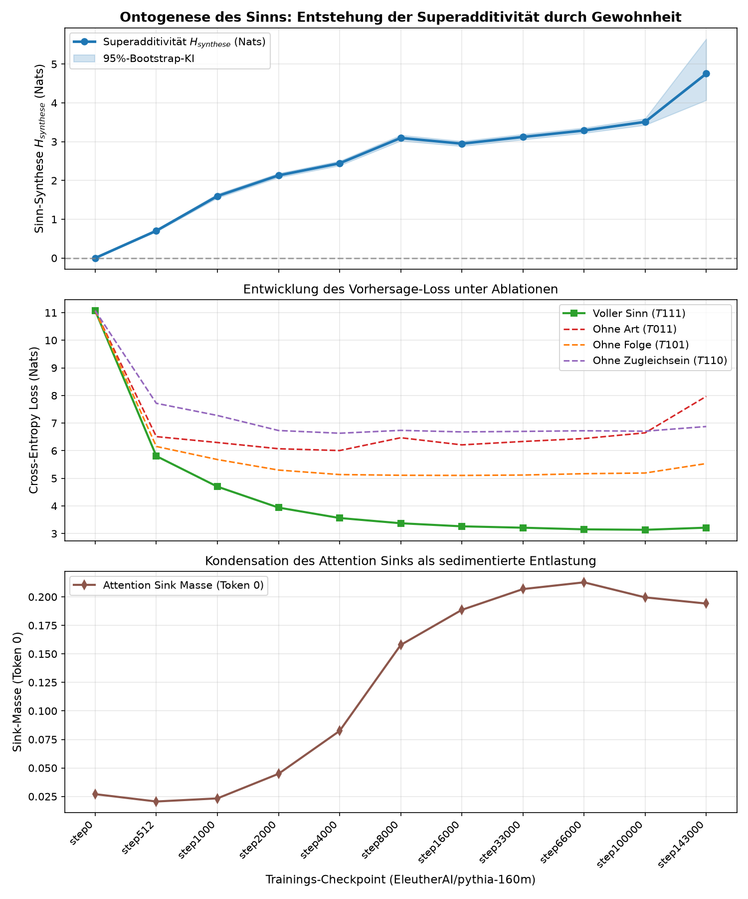

# Analysebericht: Gewöhnung über 11 Checkpoints (Pythia-160m)

**Präregistrierung:** `PRAEREG_7_gewoehnung.md` (erst zusammen mit den Ergebnissen committet, daher nicht nachweislich vor dem Lauf festgelegt).
**Checkpoints:** 11 Stufen von `step0` bis `step143000`

**Hinweis zur Konstruktion:** **Identische Bedingungen** (Design nicht vollständig faktoriell): T011 = T001; T110 = T100 = T010 = T000 (Stand letzter Checkpoint). Weil mehrere Bedingungen bauartbedingt zusammenfallen, reduziert sich $H_{synthese}$ algebraisch auf weniger Terme; ein positiver Wert ist dann keine unabhängige Evidenz für Synthese.

## 1. Präregistrierte Hypothesen

### H-Gewohnheit 1: $H_{synthese}(\text{step 0}) \approx 0$
- $H_{synthese} = -0.0000$, 95%-KI [-0.0011, +0.0011] (enthält 0), p = 0.5027.
- Die Präregistrierung nennt keine Schwelle für „≈ 0“; das Urteil ist deshalb nicht formal entscheidbar. Zum Vergleich: Loss T111 = 11.073, ln V ≈ 10,83 — bei Zufallsgewichten liegen alle Bedingungen am Zufallsniveau.

### H-Gewohnheit 2: $H_{synthese}(\text{step 143000}) > H_{synthese}(\text{step 0})$
- $H_{synthese}(\text{step143000}) = +4.7544$, 95%-KI [+4.0707, +5.6501].
- Gepaarte Differenz: +4.7545 (95%-KI +4.0710 bis +5.6503), p = 0.0002 → erfüllt.
- Monotonie wurde präregistriert im Titel, aber ohne Test; siehe Verlaufstabelle.

### H-Gewohnheit 3: Reihenfolge der Ablationsschäden (deskriptiv, keine Entscheidungsregel präregistriert)

Δ = Loss(Ablation) − Loss(T111) in Nats. 3a erwartet, dass ΔZugleich von Beginn an dominiert; 3b, dass ΔFolge und ΔArt erst ab mittleren Schritten wachsen.

| Checkpoint | ΔArt (T011) | ΔFolge (T101) | ΔZugleich (T110) | größter Schaden |
| :--- | :---: | :---: | :---: | :---: |
| `step0` | -0.000 | -0.000 | -0.000 | — |
| `step512` | +0.704 | +0.348 | +1.911 | Zugleich |
| `step1000` | +1.598 | +0.982 | +2.577 | Zugleich |
| `step2000` | +2.131 | +1.359 | +2.791 | Zugleich |
| `step4000` | +2.443 | +1.573 | +3.070 | Zugleich |
| `step8000` | +3.097 | +1.738 | +3.363 | Zugleich |
| `step16000` | +2.949 | +1.843 | +3.419 | Zugleich |
| `step33000` | +3.122 | +1.907 | +3.488 | Zugleich |
| `step66000` | +3.289 | +2.015 | +3.570 | Zugleich |
| `step100000` | +3.511 | +2.057 | +3.571 | Zugleich |
| `step143000` | +4.754 | +2.322 | +3.663 | Art |

### H-Gewohnheit 4: Sink-Genese (step 0 ≈ Zufall, später > 0,10)
- Zufallsniveau bei uniformer kausaler Aufmerksamkeit über die gemessenen Positionen 4…127: **0.0270** (nicht 1/N).
- step 0: **0.0270**; step143000: **0.1941**.
- Erster Checkpoint über 0,10: `step8000` (0.158)

## 2. Checkpoint-Verlaufstabelle

| Checkpoint | Loss T111 | Top-1 T111 | $H_{synthese}$ (Nats) | 95%-Bootstrap-KI | p-Wert | Sink Token 0 |
| :--- | :---: | :---: | :---: | :---: | :---: | :---: |
| `step0` | 11.073 | 0.0% | **-0.000** | [-0.001, +0.001] | 0.5027 | 0.027 |
| `step512` | 5.807 | 17.6% | **+0.704** | [+0.678, +0.731] | 0.0002 | 0.021 |
| `step1000` | 4.699 | 25.9% | **+1.598** | [+1.549, +1.652] | 0.0002 | 0.023 |
| `step2000` | 3.941 | 31.7% | **+2.131** | [+2.079, +2.185] | 0.0002 | 0.045 |
| `step4000` | 3.564 | 35.5% | **+2.443** | [+2.384, +2.502] | 0.0002 | 0.082 |
| `step8000` | 3.374 | 38.2% | **+3.097** | [+3.022, +3.170] | 0.0002 | 0.158 |
| `step16000` | 3.263 | 38.8% | **+2.949** | [+2.885, +3.014] | 0.0002 | 0.189 |
| `step33000` | 3.213 | 39.5% | **+3.122** | [+3.055, +3.192] | 0.0002 | 0.207 |
| `step66000` | 3.153 | 40.4% | **+3.289** | [+3.222, +3.357] | 0.0002 | 0.213 |
| `step100000` | 3.137 | 40.7% | **+3.511** | [+3.429, +3.597] | 0.0002 | 0.200 |
| `step143000` | 3.214 | 40.4% | **+4.754** | [+4.071, +5.650] | 0.0002 | 0.194 |

## 3. Grafik

